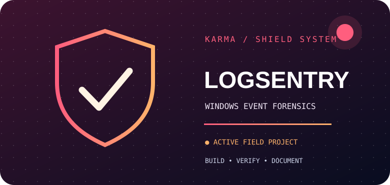
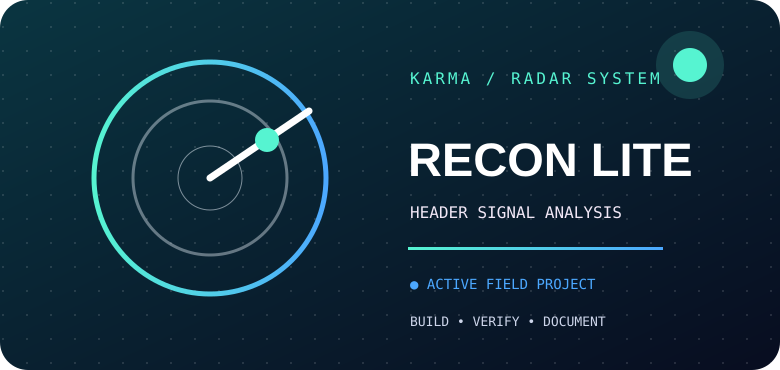
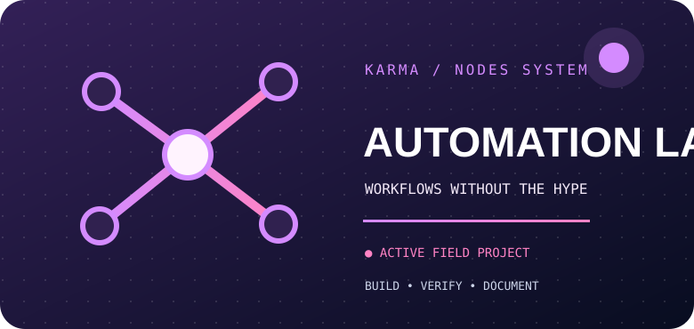
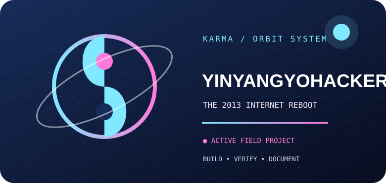
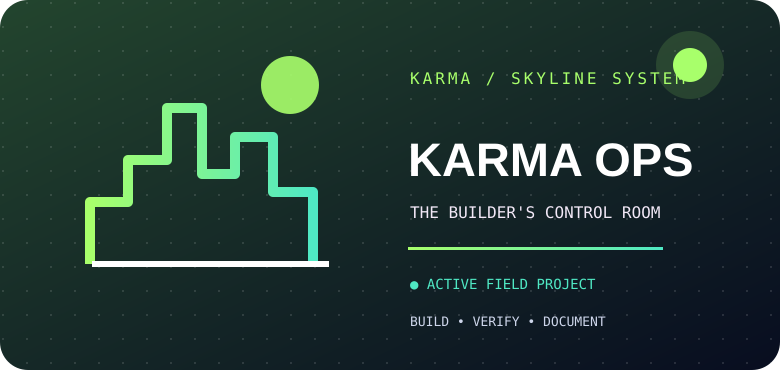

<!-- KARMA Command Deck | verified links 2026-11-06 -->
<p align="center"></p>

<p align="center"></p>

<p align="center">
  <strong>Vishwas Aithal</strong> · Defensive security · Python & JavaScript · AI workflow experiments
</p>
<p align="center">
  <a href="https://github.com/vishwasaithalz?tab=repositories">Source code</a> ·
  <a href="https://yyyh-phi.vercel.app">YinYangYoHackers</a> ·
  <a href="https://www.linkedin.com/in/vishwas-aithal">LinkedIn</a> ·
  <a href="https://www.youtube.com/@vishwasaithalz">YouTube</a>
</p>

> **🪐 From 2013 internet rabbit holes to today’s security labs.** A returning technologist building in public. I work on local-first defensive tools, safe security learning labs, reproducible automation and web engineering. This profile is a field journal of working experiments, not a claim of expert-level mastery.

## 🌈 01 / Choose your universe

Six projects, six visual identities. No duplicate cards, no fabricated metrics, no fake demo buttons.

<p align="center">






</p>

| Project | What it demonstrates | Evidence |
| :-- | :-- | :-- |
| **[LogSentry](https://github.com/vishwasaithalz/LogSentry)** | Defensive triage of imported Windows security events, with synthetic sample data and explicit investigation limits | Python CLI · [source & setup](https://github.com/vishwasaithalz/LogSentry#readme) |
| **[Recon Lite](https://github.com/vishwasaithalz/recon-lite)** | Offline-first analysis of HTTP security headers and response signals | [Signal Room demo](https://recon-lite.vercel.app) · [source](https://github.com/vishwasaithalz/recon-lite) |
| **[AI Automation Lab](https://github.com/vishwasaithalz/AI-Automation-Lab)** | Provider-neutral automation and deterministic local mock workflows | [source & local demo](https://github.com/vishwasaithalz/AI-Automation-Lab#readme) |
| **[CyberPlayground](https://github.com/vishwasaithalz/CyberPlayground)** | Browser-based educational labs for safe security concepts | [public learning labs](https://cyber-playground-nu.vercel.app) · [source](https://github.com/vishwasaithalz/CyberPlayground) |
| **[YinYangYoHackers](https://github.com/vishwasaithalz/YYYH)** | Cybersecurity learning, technical publishing and a project with roots in 2013 | [public website](https://yyyh-phi.vercel.app) · [source](https://github.com/vishwasaithalz/YYYH) |
| **[KARMA Ops Monitor](https://github.com/vishwasaithalz/KARMA-Ops-Monitor)** | Portfolio operations, visibility and engineering process | [KARMA workshop](https://karma-ops-monitor.vercel.app) · [source](https://github.com/vishwasaithalz/KARMA-Ops-Monitor) |

<sub>Public homepages checked in a read-only browser on 2026-11-06. The KARMA workshop homepage is a broader portfolio, not a standalone monitoring dashboard. Hosted landing-page checks do not certify every feature.</sub>

## 🪐 02 / The repository universe


The living orbit represents repositories and their technical relationships. [Generator](.github/workflows/karma-orbit.yml). Generated from public repository metadata by the successful GitHub Actions workflow.

## 📺 03 / Contribution signal

<picture>
  <source media="(prefers-color-scheme: dark)" srcset="assets/crt/winamp-dark.svg" />
  <source media="(prefers-color-scheme: light)" srcset="assets/crt/winamp-light.svg" />
  
</picture>

Retro Winamp-inspired contribution visualization. [Generator](.github/workflows/karma-crt.yml). Generated from real public GitHub contribution data; dark and light themes are available.

## 🐍 04 / The contribution arcade


A snake crossing the contribution grid, updated from actual public GitHub contributions when its [weekly generator](.github/workflows/karma-snake.yml) succeeds. Generated from real public GitHub contribution data by the successful GitHub Actions workflow.

## 💬 05 / The origin story

<p align="center"></p>

## 🛠️ 06 / Built, tested, documented

- **Local-first by default:** avoid uploading sensitive Windows logs or user data to public demos.
- **Testable increments:** synthetic fixtures, explicit scope and reproducible commands.
- **Authorized security work only:** research and test systems where permission is clear.
- **Readable code and documentation:** state limitations instead of presenting prototypes as production systems.

```bash
# Example: inspect real public repository metadata, no API token or write permissions
python tools/github_public_metrics.py
```

[View the metrics source](tools/github_public_metrics.py) · [Review LogSentry's merged documentation improvement](https://github.com/vishwasaithalz/LogSentry/pull/2)

## ⚡ 07 / The toolkit

<p>
  
  
  
  
  
  
</p>

## 📡 08 / The signal board

The metrics script reads **real public GitHub REST API data** for six repositories. Counts are fetched when the script runs and may be unavailable during rate limits. These counts are **not GitHub achievement awards**. Official GitHub achievements are shown by GitHub itself, not manufactured in this README.

<details><summary><strong>Explore more projects and experiments</strong></summary>

- [Flagship API](https://github.com/vishwasaithalz/flagship-api) · API engineering experiments.
- [Next.js Boilerplate](https://github.com/vishwasaithalz/nextjs-boilerplate) · Web development starter and sandbox.
- [All public repositories](https://github.com/vishwasaithalz?tab=repositories).
- [GitHub profile redesign design references](https://github.com/abhisheknaiidu/awesome-github-profile-readme).

</details>

## 🎞️ 09 / The motion vault

A tiny piece of the old internet, rebuilt for a modern README. The animation is optional; the projects and links above remain useful without it.

<p align="center"></p>
<details><summary><strong>Open the original animated artwork</strong></summary>


</details>

## 💌 10 / Find me online

[GitHub](https://github.com/vishwasaithalz) · [LinkedIn](https://www.linkedin.com/in/vishwas-aithal) · [YouTube](https://www.youtube.com/@vishwasaithalz)

<sub>Designed to be useful without remote widgets. No visitor-tracking counters, fabricated stars, fake achievements or private project disclosures. © Vishwas Aithal.</sub>

## 📡 Open Comms · Contact KARMA

<a href="mailto:vishwas.ptv@gmail.com"></a>

<sub>All generated activity displays use public GitHub information. No private repository names or confidential logs are intentionally included. Animated SVGs provide reduced-motion fallbacks where supported.</sub>
