<!-- Vishwas Aithal personal GitHub | original retro desktop art | no long dash punctuation -->
<!-- VISHWAS.EXE UNIFIED THEME START -->
<div align="center">

# 💾 VISHWAS AITHAL // BOOTDISK 1995

### BOOTDISK 1995 · VISHWAS.EXE · SYSTEM ONLINE

<a href="https://vishwasaithalz.github.io/vishwasaithalz/"></a>

### [▶ PRESS START · BOOT THE COMPUTER](https://vishwasaithalz.github.io/vishwasaithalz/)

**[🎮 ARCADE](https://vishwasaithalz.github.io/vishwasaithalz/arcade/) · [🖥️ OVERLOAD](https://vishwasaithalz.github.io/vishwasaithalz/overload/) · [📼 INTERNET MUSEUM](https://vishwasaithalz.github.io/vishwasaithalz/museum/) · [💾 MEMORY OS](https://vishwasaithalz.github.io/vishwasaithalz/memory/)**

</div>
<p align="center"><strong>VISHWAS AITHAL / PSYCHKARMA AFTER HOURS</strong><br/><sub>BOOTDISK 1995 | 2000s gamer | 2013 Blogger | Security and software now</sub></p>
<p align="center">
<a href="https://vishwasaithalz.github.io/vishwasaithalz/"><strong>▶ PRESS START / BOOT THE COMPUTER</strong></a> &nbsp;·&nbsp;
<a href="https://vishwasaithalz.github.io/vishwasaithalz/arcade/"><strong>🎮 PLAY THE ARCADE</strong></a> &nbsp;·&nbsp;
<a href="https://vishwasaithalz.github.io/vishwasaithalz/overload/"><strong>🖥️ OPEN THE WORKBENCH</strong></a> &nbsp;·&nbsp;
<a href="https://github.com/vishwasaithalz?tab=repositories"><strong>⌨️ SOURCE CODE</strong></a> &nbsp;·&nbsp;
<a href="https://vishwasaithal.ai.studio/"><strong>🌐 PORTFOLIO</strong></a>
</p>
<!-- VISHWAS.EXE UNIFIED THEME END -->
<p align="center"><a href="https://vishwasaithalz.github.io/vishwasaithalz/"></a></p>
<p align="center"><sub><strong>▶ BOOT REPLAY</strong> · The animation plays in the profile; interactive era controls, original games and the terminal open on GitHub Pages.</sub></p>


<p align="center">
<a href="https://github.com/vishwasaithalz?tab=repositories"></a>
<a href="https://yyyh-phi.vercel.app">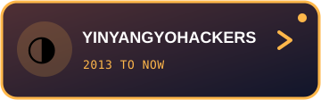</a>
<a href="https://www.linkedin.com/in/vishwas-aithal">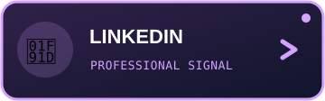</a>
<a href="https://www.youtube.com/@vishwasaithalz"></a>
</p>

> **I started by exploring every corner of a Windows desktop.** Windows desktops, Winamp playlists, virtual drives, compressed game folders, Saturday morning cartoons, a 2013 tech blog, and a stubborn curiosity about how computers work. Today that curiosity shows up as defensive security tools, websites, automation and experiments you can actually inspect. **The wallpaper changed. The curiosity didn't.**

<p align="center">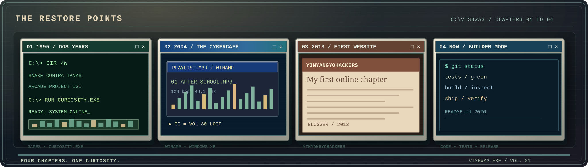</p>

<p align="center"><sub>1990s CRT &gt; 2000s Windows desktop &gt; 2013 Blogger &gt; today's engineering labs. One continuous story.</sub></p>

<details>
<summary><strong>💾 OPEN THE BONUS DISK | Full-size original retro desktop artwork</strong></summary>

<p align="center"></p>

</details>


<p align="center"><a href="https://vishwasaithalz.github.io/vishwasaithalz/arcade/#snake"><strong>🐍 SNAKE</strong></a> &nbsp;·&nbsp; <a href="https://vishwasaithalz.github.io/vishwasaithalz/arcade/#pinball"><strong>🕹 PINBALL</strong></a> &nbsp;·&nbsp; <a href="https://vishwasaithalz.github.io/vishwasaithalz/arcade/#chat"><strong>💬 STORY CHAT</strong></a> &nbsp;·&nbsp; <a href="https://vishwasaithalz.github.io/vishwasaithalz/arcade/#terminal"><strong>⌨ LIVE TERMINAL</strong></a></p>

## 💾 00 / `C:\VISHWAS\MEMORIES\README.TXT`

**From Windows 95 to Windows 11, before repositories there were desktop shortcuts. Before CI, there was the excitement of a successful installation.** This is the software-and-pop-culture time capsule behind my tech journey.

| Folder | Core memory |
| :-- | :-- |
| 🎧 **MUSIC & MEDIA** | Winamp skins, VLC playlists, watching the equalizer dance |
| 💿 **VIRTUAL DRIVES** | Daemon Tools, PowerISO, mounting ISOs and figuring out what a disc image actually was |
| 🧰 **PC MAINTENANCE** | CCleaner, Registry Mechanic and the great tradition of trying to make Windows faster |
| 📦 **DOWNLOADS** | WinRAR, Internet Download Manager, µTorrent and folders named `final_v2_really_final` |
| 🎮 **GAME.EXE** | Snake, Mario, Contra, Tanks (Battle City), Virtua Cop 2, Project I.G.I. and Counter-Strike |
| 📺 **CARTOON BREAK** | Dexter's Laboratory, Johnny Bravo, Popeye, The Powerpuff Girls, Power Rangers S.P.D., Pokémon and Beyblade |
| 🌐 **FIRST WEB CHAPTER** | Blogger, YinYangYoHackers, curiosity-driven experiments and the beginning of my online tech archive |

### 🖥️ System restore points

```text
C:\> dir /b MY_LIFE
WINDOWS_95_TO_WINDOWS_11\    A lifetime of desktops and experiments
AFTER_SCHOOL\                 Games, cartoons, computer shops, curiosity
2013_BLOGGER\                 YinYangYoHackers and learning in public
NOW\                          Python, JavaScript, AI, web and defensive security

C:\> type STATUS.TXT
Still curious. Still building. Still pressing every button.
```

**My personality settings:** a little Dexter's Laboratory, a little old-school PC repair shop, a lot of late-night tinkering. I like tech that feels alive, but I still want the code to be understandable, the demos to be real and the security work to be authorized.

<p align="center"><a href="https://vishwasaithalz.github.io/vishwasaithalz/memory/"><strong>💾 BOOT MEMORY OS</strong></a> &nbsp;·&nbsp; <a href="https://vishwasaithalz.github.io/vishwasaithalz/arcade/#snake"><strong>▶ OPEN ARCADE</strong></a> &nbsp;·&nbsp; <a href="https://yyyh-phi.vercel.app"><strong>🌐 OPEN THE BLOG ERA</strong></a> &nbsp;·&nbsp; <a href="https://github.com/vishwasaithalz?tab=repositories"><strong>📁 OPEN PROJECTS</strong></a></p>

---

## 🗂️ 01 / PROGRAM FILES / MY PROJECTS

**Six real shortcuts, six distinct personalities.** These icons open public source code or working demos, not decorative dead ends.

<p align="center">
<a href="https://github.com/vishwasaithalz/LogSentry"></a>
<a href="https://recon-lite.vercel.app">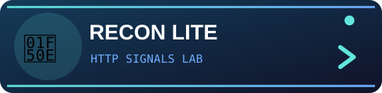</a>
<a href="https://github.com/vishwasaithalz/AI-Automation-Lab">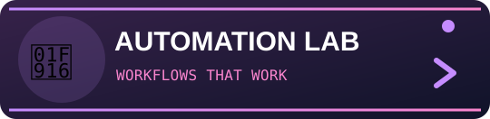</a>
<a href="https://cyber-playground-nu.vercel.app">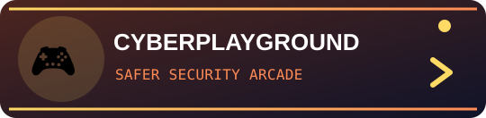</a>
<a href="https://yyyh-phi.vercel.app"></a>
<a href="https://karma-ops-monitor.vercel.app">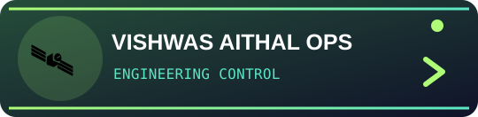</a>
</p>

<details>
<summary><strong>🧪 Show the technical details and source links</strong></summary>

| Project | Scope | Evidence |
| :-- | :-- | :-- |
| [LogSentry](https://github.com/vishwasaithalz/LogSentry) | Imported Windows security event analysis | Python CLI, synthetic fixtures, explicit investigation limits |
| [Recon Lite](https://github.com/vishwasaithalz/recon-lite) | HTTP security-header and response analysis | [Public Signal Room demo](https://recon-lite.vercel.app) |
| [AI Automation Lab](https://github.com/vishwasaithalz/AI-Automation-Lab) | Provider-neutral workflow experiments | Deterministic local mock examples |
| [CyberPlayground](https://github.com/vishwasaithalz/CyberPlayground) | Browser-based security education | [Public learning labs](https://cyber-playground-nu.vercel.app) |
| [YinYangYoHackers](https://github.com/vishwasaithalz/YYYH) | Cybersecurity learning and technology publishing | [Public website](https://yyyh-phi.vercel.app) |
| [Vishwas Aithal Ops Monitor](https://github.com/vishwasaithalz/KARMA-Ops-Monitor) | Portfolio and engineering operations | [Vishwas Aithal workshop](https://karma-ops-monitor.vercel.app) |

Public homepages were inspected in a browser on 2026-11-06. A working landing page does not certify every feature. LogSentry and AI Automation Lab have local CLI or mock examples, not a claimed hosted equivalent.
</details>


---

## 💥 EXTRA PACK 02 / THE OVERLOAD COMPUTER

<a href="https://vishwasaithalz.github.io/vishwasaithalz/overload/">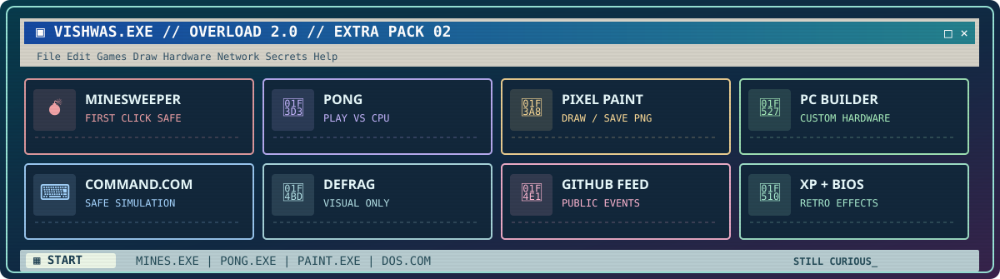</a>

The after-school PC, now with more buttons than anyone reasonably needs. **This expansion contains playable original Minesweeper and Pong, a working pixel painting canvas with PNG export, a playful PC parts selector, a safe terminal, a visual-only defrag toy, a retro BIOS boot screen, an XP-style fake welcome screen, an original screensaver and user-triggered synthesized boot tones.**

**A separate illustrated Network Neighborhood** maps eight public GitHub repositories as clickable nodes. The main dashboard can optionally request recent *public* GitHub events without a token. Real source links remain front and center, private repository contents never enter the display, and the apps use no third-party scripts or tracking.

<p align="center"><a href="https://vishwasaithalz.github.io/vishwasaithalz/overload/"><strong>💥 BOOT OVERLOAD 2.0</strong></a> &nbsp;·&nbsp; <a href="https://vishwasaithalz.github.io/vishwasaithalz/overload/game-room.html"><strong>🚀 BONUS GAMES</strong></a> &nbsp;·&nbsp; <a href="https://vishwasaithalz.github.io/vishwasaithalz/overload/network.html"><strong>🌐 NETWORK MAP</strong></a> &nbsp;·&nbsp; <a href="https://vishwasaithalz.github.io/vishwasaithalz/overload/capsule.html"><strong>💾 FLOPPY CAPSULE</strong></a> &nbsp;·&nbsp; <a href="https://vishwasaithalz.github.io/vishwasaithalz/overload/tracker.html"><strong>🎚️ TRACKER STUDIO</strong></a></p>

<details><summary><strong>📟 View Overload 2.0 app directory</strong></summary>

| Shortcut | What it does |
| :-- | :-- |
| `MINES.EXE` | Original 9×9 Minesweeper with first-click protection, flags, timer and a local personal best |
| `PONG.EXE` | Original canvas Pong against a scripted CPU opponent, with keyboard and touch controls |
| `PAINT.EXE` | Draw with touch, mouse or pen, erase, resize brush and export a locally generated PNG |
| `HARDWARE.EXE` | Select example PC parts and copy the resulting illustrative configuration |
| `COMMAND.COM` | Read-only local simulated commands such as `help`, `whoami`, `dir` and `projects` |
| `DEFRAG.EXE` | A color-block sorting animation that never touches a disk |
| `NETWORK.EXE` | Optional read-only request for publicly visible GitHub activity |
| `BIOS.EXE` | Original boot sequence, opt-in synthesized tones and fake XP-inspired welcome screen |
| `SCREEN.EXE` | Animated retro screensaver with an exit control and Escape key |
| `CONTROL.EXE` | Four color schemes, keyboard shortcuts and a secret nostalgia Easter egg |
| `STARFIGHTER.EXE` | Original geometric space shooter with waves, score and keyboard or touch controls |
| `PIXEL RACER.EXE` | Original three-lane avoidance racer with local best distance and increasing speed |
| `NEIGHBORHOOD.EXE` | Accessible SVG map linking eight public repositories, not a real infrastructure topology |
| `FLOPPY.EXE` | Four browser-only virtual disks for personal notes, downloadable as a TXT backup |
| `BSOD-PARODY.EXE` | Harmless blue-screen joke with an explicit exit and no actual system access |
| `TRACKER.EXE` | Original user-created 16-step Web Audio rhythm patterns with four synthesized voices, tempo control, local saving and JSON export |

**Keyboard controls:** Alt+1 Minesweeper · Alt+2 Pong · Alt+3 Paint · Alt+4 PC Builder · Alt+B BIOS · Alt+S screensaver.

**Bonus disk count:** Four playable games across the Overload desktop and original game room, plus drawing, PC concepts, project mapping, a private local memory vault and an opt-in original audio tracker.

<sub>Static website, not an operating system. No authentication, real network scans, disk defragmentation, commercial game downloads or fabricated GitHub achievements. Personal best saved only on your device if local storage is available.</sub>
</details>

---

## 🏛️ BONUS DISC / THE INTERNET MUSEUM

<a href="https://vishwasaithalz.github.io/vishwasaithalz/museum/">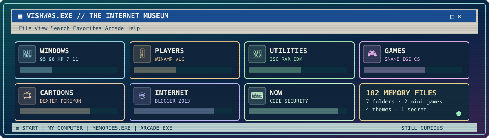</a>

**102 memory files, seven collections, two playable mini-games and four desktop themes.** Open the archive, search for classic software and cartoons, collect favorites locally or find the secret keyboard Easter egg. It is a tribute to the PC culture that shaped my curiosity, not an installer archive.

<p align="center"><a href="https://vishwasaithalz.github.io/vishwasaithalz/museum/"><strong>💾 EXPLORE ALL 102 MEMORIES</strong></a> &nbsp;·&nbsp; <a href="https://vishwasaithalz.github.io/vishwasaithalz/memory/"><strong>🖥️ RETURN TO MEMORY OS</strong></a></p>

<details>
<summary><strong>📦 Open the full expansion pack manifest</strong></summary>

| Memory directory | Included |
| :-- | :-- |
| `C:\WINDOWS\` | Windows 95 through Windows 11, CRT monitors, floppy disks, CDs, keyboards, USB drives |
| `C:\MUSIC\` | Winamp, VLC, Media Player, AIMP, foobar2000, RealPlayer and skins |
| `C:\UTILITIES\` | Daemon Tools, PowerISO, WinRAR, 7-Zip, IDM, µTorrent, CCleaner, Task Manager, Paint and more |
| `C:\GAMES\` | Snake, Contra, Mario, Tanks, Virtua Cop 2, Project I.G.I., Counter-Strike, Minesweeper, pinball and more |
| `C:\CARTOONS\` | Dexter, Johnny Bravo, Powerpuff Girls, Popeye, Pokémon, Beyblade, Power Rangers S.P.D. and more |
| `C:\INTERNET\` | Internet Explorer, Firefox, Yahoo Messenger, MSN, Orkut, Blogger and the early web |
| `C:\WORKBENCH\` | Python, JavaScript, Git, GitHub Actions, safe security tools and public engineering labs |

**Extra interactions:** instant search, category and era filters, randomly selected nostalgia, saved favorites on your device, original memory-matching game, six-question retro quiz, silent animated equalizer, local-only achievements, four color themes and a hidden classic keyboard-code surprise.

<sub>Entertainment names are nostalgia references. No third-party executables, copyrighted games, music or cartoons are distributed. Local achievements are not GitHub achievements. No tracking or public guestbook.</sub>

</details>

---

## 🌐 02 / NETWORK NEIGHBORHOOD

<a href="https://vishwasaithalz.github.io/vishwasaithalz/arcade/#roulette">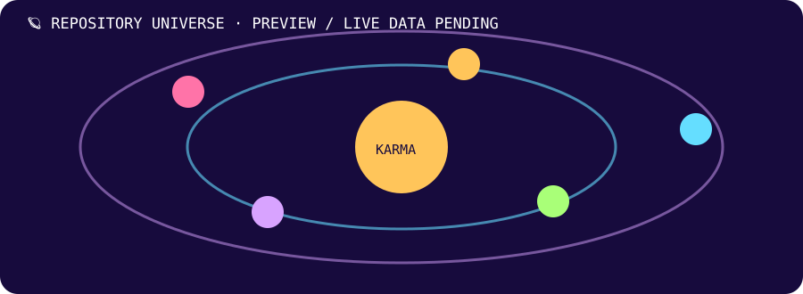</a>

Real public repository relationships, generated by GitHub Actions. Tap the orbit to open the interactive project roulette.

## 🎚️ 03 / WINAMP-STYLE CONTRIBUTION MIX

<a href="https://github.com/vishwasaithalz/vishwasaithalz/actions/workflows/karma-crt.yml">
<picture>
<source media="(prefers-color-scheme: dark)" srcset="assets/crt/winamp-dark.svg" />
<source media="(prefers-color-scheme: light)" srcset="assets/crt/winamp-light.svg" />
</picture>
</a>

A Winamp-inspired chart generated from real public contribution data, not a fictional score.

## 🐍 04 / SNAKE.EXE

<a href="https://vishwasaithalz.github.io/vishwasaithalz/arcade/#snake"></a>

The GitHub graph powers this animation. The clickable Snake game has keyboard controls and a mobile touch pad, with no uploaded scores.

## 💬 05 / THE CHAT WINDOW

<p align="center"><a href="https://vishwasaithalz.github.io/vishwasaithalz/arcade/#chat"></a></p>

**💬 Real input, local replies.** The linked chat accepts questions about the 2013 blog, security labs, automation and projects. It is a scripted interactive timeline, not a human operator or live AI assistant.

<p align="center"><a href="https://vishwasaithalz.github.io/vishwasaithalz/arcade/#chat">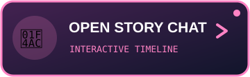</a></p>

## ⌨️ 06 / DOS PROMPT TO MODERN TERMINAL

<p align="center"><a href="https://vishwasaithalz.github.io/vishwasaithalz/arcade/#terminal"></a></p>

Try `help`, `projects`, `story`, `status`, `open logsentry`, or `snake`. The browser terminal is interactive, but it does **not** execute real shell commands or access anyone's computer.

<p align="center">
<a href="https://vishwasaithalz.github.io/vishwasaithalz/arcade/#terminal"></a>
<a href="https://vishwasaithalz.github.io/vishwasaithalz/arcade/#roulette"></a>
</p>

## 🛠️ 07 / BEHIND THE SCREEN

- **Privacy by default:** local-first projects and no public upload of private event logs.
- **Authorized security research only:** work on systems with explicit permission.
- **Reproducible experiments:** synthetic fixtures, tests, documented limitations.
- **A real GitHub API utility:** public metadata via a read-only Python script.

```bash
# Public repository information only. No API token or write access required.
python tools/github_public_metrics.py
```

<p align="center">
<a href="https://github.com/vishwasaithalz/vishwasaithalz/blob/main/tools/github_public_metrics.py"></a>
<a href="https://github.com/vishwasaithalz/LogSentry/pull/2"></a>
</p>

## ⚡ 08 / CURRENTLY INSTALLED

<p align="center">


</p>

## 📡 09 / SYSTEM INFORMATION

The public metadata script fetches the current repository information only when run. Read its code to confirm what it does. Counts do not imply official GitHub achievements or rankings.

<p align="center">
<a href="https://github.com/vishwasaithalz?tab=repositories"></a>
<a href="https://karma-ops-monitor.vercel.app"></a>
</p>

<details>
<summary>🧰 More experiments and design references</summary>

- [Flagship API](https://github.com/vishwasaithalz/flagship-api): API engineering experiments.
- [Next.js Boilerplate](https://github.com/vishwasaithalz/nextjs-boilerplate): starter and sandbox.
- [Profile design catalog](https://github.com/abhisheknaiidu/awesome-github-profile-readme): open-source inspiration.
- [Real animation workflows](https://github.com/vishwasaithalz/vishwasaithalz/actions): see GitHub Actions runs.

</details>

## 🕹️ ARCADE 3.0 / A playable workshop

The Vishwas Aithal Arcade includes an original physics pinball table, Snake, a local scripted story chat, a read-only simulated terminal and a project roulette. No gameplay data is sent to an external service.

<p align="center">
<a href="https://vishwasaithalz.github.io/vishwasaithalz/arcade/#pinball">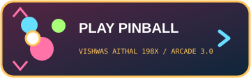</a>
<a href="https://vishwasaithalz.github.io/vishwasaithalz/arcade/#roulette"></a>
</p>

<details>
<summary><strong>🎞 Open six project-specific original animated GIFs</strong></summary>

<p align="center">
<a href="https://github.com/vishwasaithalz/LogSentry">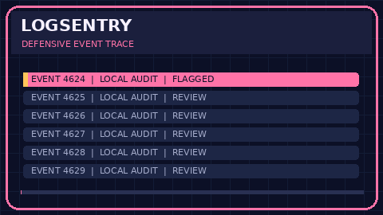</a>
<a href="https://recon-lite.vercel.app">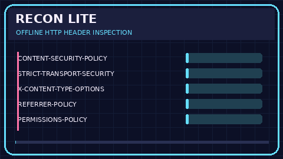</a>
<a href="https://github.com/vishwasaithalz/AI-Automation-Lab">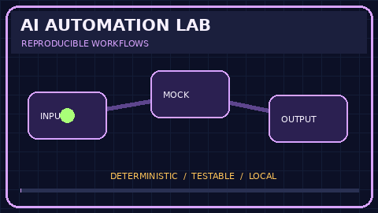</a>
<a href="https://cyber-playground-nu.vercel.app">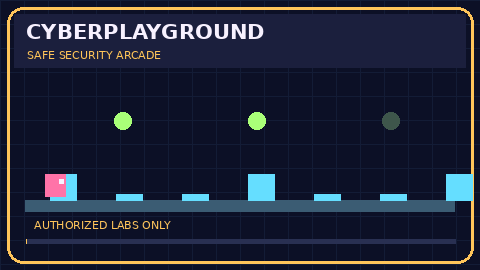</a>
<a href="https://yyyh-phi.vercel.app">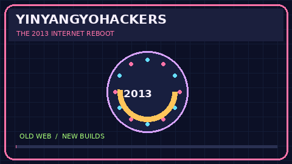</a>
<a href="https://karma-ops-monitor.vercel.app">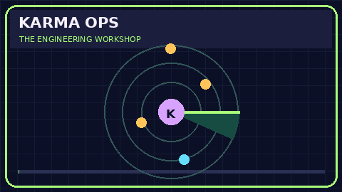</a>
</p>

Each clip depicts the project's theme. Graphics do not represent live security findings, simulated user data or measured production performance.

</details>

## 🎞️ 10 / SCREENSAVER VAULT

<a href="https://vishwasaithalz.github.io/vishwasaithalz/arcade/">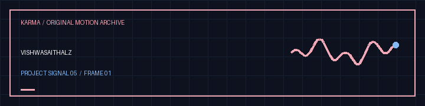</a>

<details><summary>Open the original orbital artwork</summary>
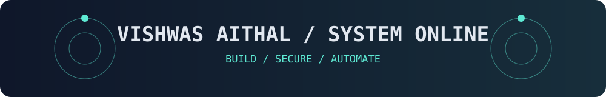
</details>

### 🧪 Six live Vishwas Aithal engineering labs

Six independent Vercel workbenches with source code, automated tests and daily HTTP checks. These are educational and engineering prototypes, **not** production security guarantees or measured performance achievements.

| Project | Live demo | Source and tests |
|:--|:--|:--|
| **SentinelPulse** | [Security lab](https://karma-sentinelpulse.vercel.app/) | [Source](https://github.com/vishwasaithalz/AI-Automation-Lab/tree/main/projects/SentinelPulse) |
| **SERPMatrix** | [SEO lab](https://karma-serpmatrix.vercel.app/) | [Source](https://github.com/vishwasaithalz/AI-Automation-Lab/tree/main/projects/SERPMatrix) |
| **CloudHardener** | [Kubernetes lab](https://karma-cloudhardener.vercel.app/) | [Source](https://github.com/vishwasaithalz/AI-Automation-Lab/tree/main/projects/CloudHardener) |
| **ApexVitals** | [Performance lab](https://karma-apexvitals.vercel.app/) | [Source](https://github.com/vishwasaithalz/AI-Automation-Lab/tree/main/projects/ApexVitals) |
| **ZeroAuth** | [Passkey lab](https://karma-zeroauth.vercel.app/) | [Source](https://github.com/vishwasaithalz/AI-Automation-Lab/tree/main/projects/ZeroAuth) |
| **Spectra UI** | [Accessibility lab](https://karma-spectra-ui.vercel.app/) | [Source](https://github.com/vishwasaithalz/AI-Automation-Lab/tree/main/projects/SpectraUI) |

[Explore all six project folders](https://github.com/vishwasaithalz/AI-Automation-Lab/tree/main/projects) · [Live uptime checks](https://github.com/vishwasaithalz/AI-Automation-Lab/actions/workflows/karma-live-endpoints.yml)

## 💌 11 / SEND A MESSAGE

**Verified owner supplied social destinations:** [X: @vishwasaithalz](https://x.com/vishwasaithalz) · [LinkedIn](https://www.linkedin.com/in/vishwas-aithal/) · [Quora](https://www.quora.com/profile/Vishwasaithal) · [YouTube](https://www.youtube.com/@vishwasaithalz)


<a href="mailto:vishwas.ptv@gmail.com">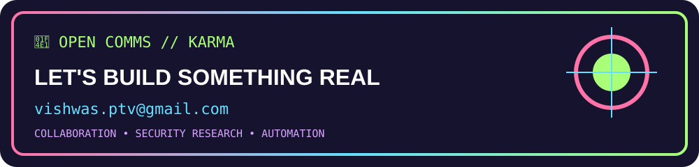</a>

<p align="center">
<a href="https://www.linkedin.com/in/vishwas-aithal"></a>
<a href="https://www.youtube.com/@vishwasaithalz"></a>
<a href="https://github.com/vishwasaithalz"></a>
</p>

<sub>Public project demonstrations only. No private repository names are exposed. Animated SVGs include reduced-motion styling where supported. The arcade runs locally in the browser with no analytics or API calls. © Vishwas Aithal.</sub>
