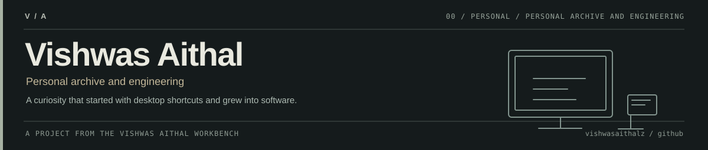

<!-- VISHWAS.EXE UNIFIED THEME START -->

  

# Vishwas Aithal

I got into computers by opening every folder and trying to understand what was inside. Windows, Winamp, old games and a lot of trial and error eventually led to a technology blog in 2013. Now I'm building small software projects around **web development, automation and defensive security**.

I like clear documentation, working examples and tools that are honest about their limitations.

[Personal website](https://vishwasaithalz.github.io/vishwasaithalz/) · [Portfolio](https://vishwasaithal.ai.studio/) · [LinkedIn](https://www.linkedin.com/in/vishwas-aithal) · [All repositories](https://github.com/vishwasaithalz?tab=repositories)

<!-- VISHWAS.EXE UNIFIED THEME END -->

## Selected work

| Project | What I am exploring |
| :-- | :-- |
| [LogSentry](https://github.com/vishwasaithalz/LogSentry) | Reviewing exported Windows event data in a local-first defensive workflow |
| [CyberPlayground](https://github.com/vishwasaithalz/CyberPlayground) | Interactive security education in the browser |
| [Recon Lite](https://github.com/vishwasaithalz/recon-lite) | Offline inspection of saved HTTP response headers |
| [AI Automation Lab](https://github.com/vishwasaithalz/AI-Automation-Lab) | Reproducible workflow experiments, mock integrations and tests |
| [Flagship API](https://github.com/vishwasaithalz/flagship-api) | Small Node.js APIs with explicit contracts and validation |
| [Next.js Boilerplate](https://github.com/vishwasaithalz/nextjs-boilerplate) | A practical foundation for React and TypeScript projects |
| [Ops Monitor](https://github.com/vishwasaithalz/KARMA-Ops-Monitor) | Public CI signals and engineering operations |
| [YinYangYoHackers](https://github.com/vishwasaithalz/YYYH) | Revisiting the technology blog where I started writing in 2013 |

The repositories contain the actual source, setup instructions, limitations and tests. The security examples are for authorized, educational or defensive use.

## The other side of the desk

I still like software with a little personality, especially the curious, homemade feeling of the early internet. Rather than loading every experiment into this README, I keep them in a small browser archive.

| Open | What you'll find |
| :-- | :-- |
| [After Hours](https://vishwasaithalz.github.io/vishwasaithalz/) | The central index and selected projects |
| [Memory OS](https://vishwasaithalz.github.io/vishwasaithalz/memory/) | A windowed retro desktop |
| [Internet Museum](https://vishwasaithalz.github.io/vishwasaithalz/museum/) | A searchable collection of 102 nostalgic items |
| [Arcade](https://vishwasaithalz.github.io/vishwasaithalz/arcade/) | Original Snake and pinball, plus small interactive experiments |
| [Overload workbench](https://vishwasaithalz.github.io/vishwasaithalz/overload/) | Minesweeper, Pong, a drawing canvas, simulated PC tools and more |

More playable experiments and utilities

- [Starfighter and Pixel Racer](https://vishwasaithalz.github.io/vishwasaithalz/overload/game-room.html): two original browser games.
- [Project network](https://vishwasaithalz.github.io/vishwasaithalz/overload/network.html): a visual map of the public repositories, not an infrastructure scan.
- [Tracker studio](https://vishwasaithalz.github.io/vishwasaithalz/overload/tracker.html): a 16-step synthesizer for original patterns only.
- [Floppy time capsule](https://vishwasaithalz.github.io/vishwasaithalz/overload/capsule.html): personal notes stored locally in your own browser.
- [The old cybercafé layout](README-archive-2026-11-09.md): the complete previous README, preserved with its artwork, animations, project links and experiments.

## A few things that stayed with me

Winamp visualizers, VLC, WinRAR, Daemon Tools, PowerISO, the early days of internet downloads, and games like Snake, Contra, I.G.I. and Counter-Strike. On the other side of the desk: Dexter's Laboratory, Johnny Bravo, Pokémon and Beyblade. Eventually I stopped just exploring software and started trying to build some of my own.

Open the original Winamp-inspired contribution display

This graphic is generated by a public GitHub workflow. It is not a fabricated score. The rest of the original artwork is in the [archived README](README-archive-2026-11-09.md).

## Small engineering notes

Most of the work here is exploratory. I try to keep the interesting bits accessible: source code, reproducible commands, explicit tradeoffs and boundaries around sensitive data.

If you want to see the actual state of the projects, use the [GitHub Actions runs](https://github.com/vishwasaithalz/vishwasaithalz/actions) rather than decorative status graphics. The shared visual system is documented in the [design notes](assets/brand/THEME.md).

---

[GitHub](https://github.com/vishwasaithalz) · [LinkedIn](https://www.linkedin.com/in/vishwas-aithal) · [YouTube](https://www.youtube.com/@vishwasaithalz) · [Portfolio](https://vishwasaithal.ai.studio/)

Original browser experiments are simulations or educational tools, not commercial software distributions. No private repository content or fabricated achievements are presented here. All work credited to Vishwas Aithal.
