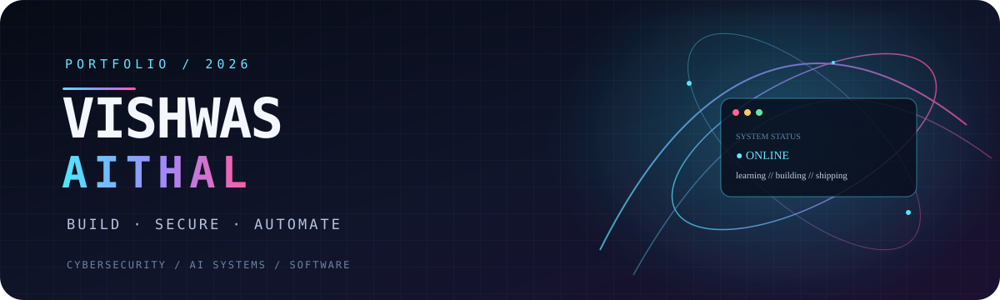
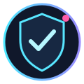
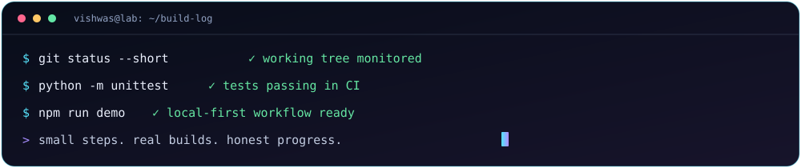
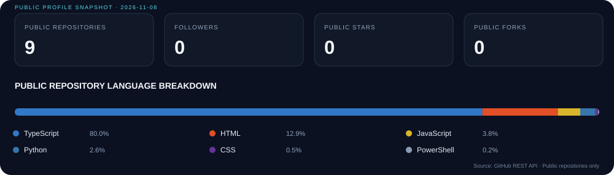

<!-- PROFILE README | visual system: midnight / neon / terminal -->

  

  
  
  
  

  <a href="#-mission-control">Mission Control</a> ·
  <a href="#-featured-builds">Featured Builds</a> ·
  <a href="#-tech-stack">Tech Stack</a> ·
  <a href="#-current-quests">Current Quests</a> ·
  <a href="#-connect">Connect</a>

  <em>Curiosity is the exploit. Consistency is the patch.</em>

  
  &nbsp;&nbsp;
  
  &nbsp;&nbsp;
  

## 🛰️ Mission Control

I'm a returning technologist rebuilding my hands-on engineering practice through practical projects, careful experimentation, and documented learning.

My current orbit brings together **defensive security, responsible security testing, AI workflows, automation, and web development**. I like small useful tools, understandable code, repeatable tests, and security boundaries that are clear rather than decorative.

<table>
  <tr>
    <td width="50%" valign="top">
      <h3>🛡️ Security engineering</h3>
      Local-first analysis · application security · secure configuration · authorised testing
    </td>
    <td width="50%" valign="top">
      <h3>🤖 AI & automation</h3>
      Provider-neutral workflows · API integrations · repeatable automation · privacy-aware design
    </td>
  </tr>
  <tr>
    <td width="50%" valign="top">
      <h3>🌐 Software & web</h3>
      JavaScript · TypeScript · Python · Node.js · React · APIs
    </td>
    <td width="50%" valign="top">
      <h3>🧪 Build philosophy</h3>
      Test first · document limits · keep dependencies lean · ship useful increments
    </td>
  </tr>
</table>

  

## 🚀 Featured Builds

> A workshop in progress. Each project is labelled honestly, with scope and maturity visible in its own repository.

<table>
  <tr>
    <td width="50%" valign="top">
      <h3>🌓 YinYangYoHackers</h3>
      <strong>Security · Open source · Knowledge</strong> 
      Long-running cybersecurity and open-source technology project, with roots in 2013.
        
      <a href="https://yyyh-phi.vercel.app">↗ Visit live site</a> · <a href="https://github.com/vishwasaithalz/YYYH">↗ Public source</a>
        
      Active foundation · Content preservation and modernization
    </td>
    <td width="50%" valign="top">
      <h3>🔎 LogSentry</h3>
      <strong>Python · Windows · Local-first</strong> 
      A lightweight analyzer for imported Windows security event data, with filters and JSON/CSV reporting.
        
      <a href="https://github.com/vishwasaithalz/LogSentry">↗ Public source</a>
        
      Early build · Synthetic sample data · Unit tests
    </td>
  </tr>
  <tr>
    <td width="50%" valign="top">
      <h3>🧩 CyberPlayground</h3>
      <strong>HTML · CSS · JavaScript</strong> 
      Safe browser-based learning labs for HTTP security headers, password entropy concepts, and input handling.
        
      <a href="https://github.com/vishwasaithalz/CyberPlayground">↗ Public source</a>
        
      Learning playground · No target scanning or telemetry
    </td>
    <td width="50%" valign="top">
      <h3>⚙️ AI-Automation-Lab</h3>
      <strong>Node.js · Workflow design · APIs</strong> 
      Provider-neutral workflow experiments with a deterministic local mock mode.
        
      <a href="https://github.com/vishwasaithalz/AI-Automation-Lab">↗ Public source</a>
        
      Early build · No external AI provider required for demo
    </td>
  </tr>
</table>

  
<strong>🧰 More workshop shelves</strong>

   
  - **Recon Lite** · HTTP response and security-header analysis · [Public source](https://github.com/vishwasaithalz/recon-lite).
  - **Flagship API** · API engineering experiments · [Public source](https://github.com/vishwasaithalz/flagship-api).
  - **Next.js Boilerplate** · Starter template / sandbox · [Public source](https://github.com/vishwasaithalz/nextjs-boilerplate).

## 🧬 Tech Stack

  
  
  
  
  
  
  
  
  

Technologies in practical use or active learning. This is a build log, not a claim of expert-level mastery.

## 🎯 Current Quests

- [ ] Grow LogSentry into a more useful Windows event investigation workflow.
- [ ] Expand CyberPlayground with safe, interactive application-security exercises.
- [ ] Add carefully scoped AI provider adapters with explicit secret handling.
- [ ] Strengthen API engineering, Python testing, and secure development fundamentals.
- [ ] Keep every project documented, reproducible, and honest about its limitations.

## 📊 GitHub profile snapshot

  

  <a href="https://github.com/vishwasaithalz?tab=repositories">Explore all public repositories ↗</a> ·
  <a href="https://github.com/vishwasaithalz/vishwasaithalz/actions/workflows/refresh-profile-stats.yml">Statistics refresh workflow ↗</a>

Generated from GitHub's public REST API and stored in this repository. GitHub Actions refreshes the snapshot weekly and can also be run manually. Language percentages reflect source bytes reported by GitHub across owned public repositories; private activity is excluded.

## 🧭 Build Rules

| Principle | How it shows up in my work |
|---|---|
| 🔐 Privacy first | Local-first defaults; secrets stay out of Git |
| 🧪 Evidence over hype | Test behaviour before calling something working |
| 🧱 Small useful releases | Build a working core before adding complexity |
| 🧭 Responsible security | Test only systems and data I am authorised to assess |
| 🛠️ Maintainability | Prefer clear code, lean dependencies, and useful docs |

## 🤝 Connect

If you're building practical security tools, privacy-aware automation, or useful open-source software, I'd be glad to connect.

  
  

  <strong>BUILD SMALL. SECURE WELL. KEEP GOING. ⚡</strong> 
  © Vishwas Aithal · Personal engineering portfolio

<!-- KARMA VISUAL IDENTITY: START -->

**BUILD / SECURE / AUTOMATE**

 

Designed for clarity. Built for evidence. No invented status metrics.

<!-- KARMA VISUAL IDENTITY: END -->

<!-- KARMA ORBIT SHOWCASE -->

<strong>🎛️ KARMA interactive project selector</strong>

| Choose a station | Open project |
|:--|:--|
| 🛰️ Operations | [KARMA Ops Monitor](https://github.com/vishwasaithalz/KARMA-Ops-Monitor) |
| 🛡️ Security | [LogSentry](https://github.com/vishwasaithalz/LogSentry) |
| 🧪 Learning | [CyberPlayground](https://github.com/vishwasaithalz/CyberPlayground) |
| 🤖 Automation | [AI Automation Lab](https://github.com/vishwasaithalz/AI-Automation-Lab) |
| 🌓 Publishing | [YinYangYoHackers](https://github.com/vishwasaithalz/YYYH) |

<!-- KARMA AVATAR GALLERY -->

<a href="https://karma-ops-monitor.vercel.app/#gallery">Explore the animated project gallery</a>

### Original motion gallery

[Download this profile GIF](assets/karma-motion.gif)

## 🏅 Six projects to feature

Suggested GitHub profile pins (pinning itself is managed in GitHub's profile UI):

| Project | Focus | Public source / demo |
| --- | --- | --- |
| LogSentry | Defensive Windows event triage | [Source](https://github.com/vishwasaithalz/LogSentry) · local CLI, no hosted demo claimed |
| Recon Lite | Offline HTTP header review | [Source](https://github.com/vishwasaithalz/recon-lite) · local CLI, no hosted demo claimed |
| AI-Automation-Lab | Deterministic provider-neutral workflows | [Source](https://github.com/vishwasaithalz/AI-Automation-Lab) · local mock demo |
| CyberPlayground | Security education | [Source](https://github.com/vishwasaithalz/CyberPlayground) |
| YYYH | Security publishing and learning | [Source](https://github.com/vishwasaithalz/YYYH) · [Site](https://yyyh-phi.vercel.app) |
| KARMA-Ops-Monitor | Portfolio operations and observability | [Source](https://github.com/vishwasaithalz/KARMA-Ops-Monitor) · [Site](https://karma-ops-monitor.vercel.app) |

**Public GitHub API experiment:** Run `python tools/github_public_metrics.py` to fetch current public repository star, fork, and open-issue counts using GitHub's REST API. This is a read-only, networked utility: it uses no credentials, makes no GitHub writes, and fails visibly if requests are blocked or rate-limited. Counts are not an official achievement tally. No metrics are hardcoded as accomplishments.
