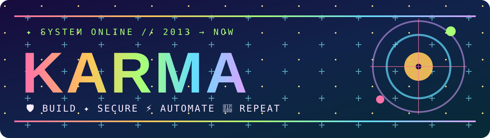

<!-- KARMA public profile | visual copy reviewed 2026-11-06 | no long dash punctuation -->
<p align="center"></p>
<p align="center"></p>
<p align="center"><strong>KARMA Command Deck: Arcade Edition</strong></p>
<p align="center"><strong>Vishwas Aithal</strong> · Defensive security · Python and JavaScript · AI workflow experiments</p>

<p align="center">
<a href="https://github.com/vishwasaithalz?tab=repositories"></a>
<a href="https://yyyh-phi.vercel.app"></a>
<a href="https://www.linkedin.com/in/vishwas-aithal"></a>
<a href="https://www.youtube.com/@vishwasaithalz"></a>
</p>

> **🪐 From a 2013 blog to modern security labs.** I'm a returning technologist building practical, local-first defensive tools, safe educational experiments, reproducible automation and public engineering notes. Read the code, try a demo, or explore the story.

<p align="center">
<a href="https://vishwasaithalz.github.io/vishwasaithalz/arcade/#snake"></a>
<a href="https://vishwasaithalz.github.io/vishwasaithalz/arcade/#pinball"></a>
<a href="https://vishwasaithalz.github.io/vishwasaithalz/arcade/#chat"></a>
<a href="https://vishwasaithalz.github.io/vishwasaithalz/arcade/#terminal"></a>
</p>

## 🌈 01 / Choose your universe

**Six projects. Six different personalities. Compact tiles that lead somewhere useful.** Tap a station to open a real public repository or demo.

<p align="center">
<a href="https://github.com/vishwasaithalz/LogSentry"></a>
<a href="https://recon-lite.vercel.app"></a>
<a href="https://github.com/vishwasaithalz/AI-Automation-Lab"></a>
<a href="https://cyber-playground-nu.vercel.app"></a>
<a href="https://yyyh-phi.vercel.app"></a>
<a href="https://karma-ops-monitor.vercel.app"></a>
</p>

<details>
<summary><strong>🧪 Show the technical details and source links</strong></summary>

| Project | Scope | Evidence |
| :-- | :-- | :-- |
| [LogSentry](https://github.com/vishwasaithalz/LogSentry) | Imported Windows security event analysis | Python CLI, synthetic fixtures, explicit investigation limits |
| [Recon Lite](https://github.com/vishwasaithalz/recon-lite) | HTTP security-header and response analysis | [Public Signal Room demo](https://recon-lite.vercel.app) |
| [AI Automation Lab](https://github.com/vishwasaithalz/AI-Automation-Lab) | Provider-neutral workflow experiments | Deterministic local mock examples |
| [CyberPlayground](https://github.com/vishwasaithalz/CyberPlayground) | Browser-based security education | [Public learning labs](https://cyber-playground-nu.vercel.app) |
| [YinYangYoHackers](https://github.com/vishwasaithalz/YYYH) | Cybersecurity learning and technology publishing | [Public website](https://yyyh-phi.vercel.app) |
| [KARMA Ops Monitor](https://github.com/vishwasaithalz/KARMA-Ops-Monitor) | Portfolio and engineering operations | [KARMA workshop](https://karma-ops-monitor.vercel.app) |

Public homepages were inspected in a browser on 2026-11-06. A working landing page does not certify every feature. LogSentry and AI Automation Lab have local CLI or mock examples, not a claimed hosted equivalent.
</details>

## 🪐 02 / Your repository universe

<a href="https://vishwasaithalz.github.io/vishwasaithalz/arcade/#roulette"></a>

Real public repository relationships, generated by GitHub Actions. Tap the orbit to open the interactive project roulette.

## 📺 03 / Real contribution signal

<a href="https://github.com/vishwasaithalz/vishwasaithalz/actions/workflows/karma-crt.yml">
<picture>
<source media="(prefers-color-scheme: dark)" srcset="assets/crt/winamp-dark.svg" />
<source media="(prefers-color-scheme: light)" srcset="assets/crt/winamp-light.svg" />

</picture>
</a>

A Winamp-inspired chart generated from real public contribution data, not a fictional score.

## 🐍 04 / The contribution arcade

<a href="https://vishwasaithalz.github.io/vishwasaithalz/arcade/#snake"></a>

The GitHub graph powers this animation. The clickable Snake game has keyboard controls and a mobile touch pad, with no uploaded scores.

## 💬 05 / A story you can actually talk to

<a href="https://vishwasaithalz.github.io/vishwasaithalz/arcade/#chat"></a>

**💬 Real input, local replies.** The linked chat accepts questions about the 2013 blog, security labs, automation and projects. It is a scripted interactive timeline, not a human operator or live AI assistant.

<p align="center"><a href="https://vishwasaithalz.github.io/vishwasaithalz/arcade/#chat"></a></p>

## ⌨️ 06 / Terminal access to the workshop

<a href="https://vishwasaithalz.github.io/vishwasaithalz/arcade/#terminal"></a>

Try `help`, `projects`, `story`, `status`, `open logsentry`, or `snake`. The browser terminal is interactive, but it does **not** execute real shell commands or access anyone's computer.

<p align="center">
<a href="https://vishwasaithalz.github.io/vishwasaithalz/arcade/#terminal"></a>
<a href="https://vishwasaithalz.github.io/vishwasaithalz/arcade/#roulette"></a>
</p>

## 🛠️ 07 / Evidence, not theater

- **Privacy by default:** local-first projects and no public upload of private event logs.
- **Authorized security research only:** work on systems with explicit permission.
- **Reproducible experiments:** synthetic fixtures, tests, documented limitations.
- **A real GitHub API utility:** public metadata via a read-only Python script.

```bash
# Public repository information only. No API token or write access required.
python tools/github_public_metrics.py
```

<p align="center">
<a href="https://github.com/vishwasaithalz/vishwasaithalz/blob/main/tools/github_public_metrics.py"></a>
<a href="https://github.com/vishwasaithalz/LogSentry/pull/2"></a>
</p>

## ⚡ 08 / The toolkit

<p align="center">


</p>

## 📡 09 / The signal board

The public metadata script fetches the current repository information only when run. Read its code to confirm what it does. Counts do not imply official GitHub achievements or rankings.

<p align="center">
<a href="https://github.com/vishwasaithalz?tab=repositories"></a>
<a href="https://karma-ops-monitor.vercel.app"></a>
</p>

<details>
<summary>🧰 More experiments and design references</summary>

- [Flagship API](https://github.com/vishwasaithalz/flagship-api): API engineering experiments.
- [Next.js Boilerplate](https://github.com/vishwasaithalz/nextjs-boilerplate): starter and sandbox.
- [Profile design catalog](https://github.com/abhisheknaiidu/awesome-github-profile-readme): open-source inspiration.
- [Real animation workflows](https://github.com/vishwasaithalz/vishwasaithalz/actions): see GitHub Actions runs.

</details>

## 🕹️ ARCADE 3.0 / A playable workshop

The KARMA Arcade includes an original physics pinball table, Snake, a local scripted story chat, a read-only simulated terminal and a project roulette. No gameplay data is sent to an external service.

<p align="center">
<a href="https://vishwasaithalz.github.io/vishwasaithalz/arcade/#pinball"></a>
<a href="https://vishwasaithalz.github.io/vishwasaithalz/arcade/#roulette"></a>
</p>

<details>
<summary><strong>🎞 Open six project-specific original animated GIFs</strong></summary>

<p align="center">
<a href="https://github.com/vishwasaithalz/LogSentry"></a>
<a href="https://recon-lite.vercel.app"></a>
<a href="https://github.com/vishwasaithalz/AI-Automation-Lab"></a>
<a href="https://cyber-playground-nu.vercel.app"></a>
<a href="https://yyyh-phi.vercel.app"></a>
<a href="https://karma-ops-monitor.vercel.app"></a>
</p>

Each clip depicts the project's theme. Graphics do not represent live security findings, simulated user data or measured production performance.

</details>

## 🎞️ 10 / The original motion vault

<a href="https://vishwasaithalz.github.io/vishwasaithalz/arcade/"></a>

<details><summary>Open the original orbital artwork</summary>

</details>

### 🧪 Six live KARMA engineering labs

Six independent Vercel workbenches with source code, automated tests and daily HTTP checks. These are educational and engineering prototypes, **not** production security guarantees or measured performance achievements.

| Project | Live demo | Source and tests |
|:--|:--|:--|
| **SentinelPulse** | [Security lab](https://karma-sentinelpulse.vercel.app/) | [Source](https://github.com/vishwasaithalz/AI-Automation-Lab/tree/main/projects/SentinelPulse) |
| **SERPMatrix** | [SEO lab](https://karma-serpmatrix.vercel.app/) | [Source](https://github.com/vishwasaithalz/AI-Automation-Lab/tree/main/projects/SERPMatrix) |
| **CloudHardener** | [Kubernetes lab](https://karma-cloudhardener.vercel.app/) | [Source](https://github.com/vishwasaithalz/AI-Automation-Lab/tree/main/projects/CloudHardener) |
| **ApexVitals** | [Performance lab](https://karma-apexvitals.vercel.app/) | [Source](https://github.com/vishwasaithalz/AI-Automation-Lab/tree/main/projects/ApexVitals) |
| **ZeroAuth** | [Passkey lab](https://karma-zeroauth.vercel.app/) | [Source](https://github.com/vishwasaithalz/AI-Automation-Lab/tree/main/projects/ZeroAuth) |
| **Spectra UI** | [Accessibility lab](https://karma-spectra-ui.vercel.app/) | [Source](https://github.com/vishwasaithalz/AI-Automation-Lab/tree/main/projects/SpectraUI) |

[Explore all six project folders](https://github.com/vishwasaithalz/AI-Automation-Lab/tree/main/projects) · [Live uptime checks](https://github.com/vishwasaithalz/AI-Automation-Lab/actions/workflows/karma-live-endpoints.yml)

## 💌 11 / Open comms

<a href="mailto:vishwas.ptv@gmail.com"></a>

<p align="center">
<a href="https://www.linkedin.com/in/vishwas-aithal"></a>
<a href="https://www.youtube.com/@vishwasaithalz"></a>
<a href="https://github.com/vishwasaithalz"></a>
</p>

<sub>Public project demonstrations only. No private repository names are exposed. Animated SVGs include reduced-motion styling where supported. The arcade runs locally in the browser with no analytics or API calls. © Vishwas Aithal.</sub>
